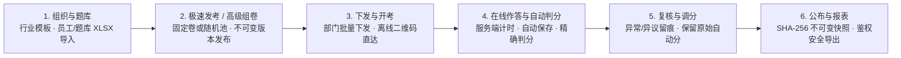

<div align="center">

# ExamOps

### 严谨、极简、零冗余依赖的企业级在线考试运营平台

**4 步极速发考 · 权限感知实时看板 · 纯本地离线部署 · 生产级审计与即时会话下线**

<p>
  
  
  
  
  
  
</p>

[为什么做 ExamOps](#-为什么做-examops) · [核心体验](#-核心体验按角色设计) · [业务全景与架构](#-业务全景与分层架构) · [工程与安全底线](#-硬核工程与生产安全) · [3 分钟启动](#-3-分钟快速启动)

</div>

---

## 💡 为什么做 ExamOps？

很多企业内网或培训考核场景并不需要臃肿的“大而全”网校系统，而是需要一套**部署简单、边界清晰、考务少折腾、考生零干扰、审计经得起查**的严肃客观题考试工具。

| 常见痛点 | ExamOps 的解法 |
|---|---|
| 建部门、建人、录题、组卷、发考要在七八个页面来回跳 | **行业组织模板一键初始化** + **员工/题库 Excel 批量导入** + **4 步极速发考向导**，一气呵成 |
| 后台长得像十年前的表格，深色模式没有、手机端挤爆 | **Swiss 理性深蓝设计系统** + **Lucian UX/UI 精致微动效** + **浅/深双色主题** + **375px 移动端适配** |
| 考试进行中不知道谁没考，还得自己导出表格比对 | **运营看板实时进度条**一点即开**催考抽屉**，按“未开始 / 作答中 / 已交卷”分组，**一键复制未考名单** |
| 员工扫码进系统，侧边栏一堆看不懂的管理菜单 | **纯考生极简免打扰模式** + **本地离线生成扫码二维码**，扫码登录后直达本场考试 |
| 停用了离职/违纪员工账号，对方开着的页面还能继续操作 | **内存广播 + 4 秒数据库探针双保险**，5 秒内强制踢下线旧 Blazor Circuit 并吊销 Cookie |
| 内网离线环境装一堆第三方 NuGet / CDN 资源直接报错 | **零额外第三方包**：`.xlsx` 解析/生成、QR 二维码 SVG 均基于 `.NET 8 BCL` 原生实现，100% 离线可用 |

---

## ✨ 核心体验（按角色设计）

### 1. 给考务管理员：少配、少点、看得清
- **📊 权限感知实时运营看板 (`/`)**
  - 按当前账号的 RBAC 权限与部门树数据范围动态组装，不越权、不堆砌。
  - 内置 **滚动数字 KPI 卡片**、**可交互重分环形图**（悬停外滑、点击图例动态重算占比）、**近期考试快速掌控表**与全局 **`Ctrl+K` 快捷命令面板**。
  - 点击任务进度条直接弹出 **考中进度与催考抽屉**，一键复制未参考人员名单发到工作群。
- **⚡ 极速发考四步向导 (`/exams/quick-publish`)**
  - **Step 1 选/传题库**：选用现有题库，或**站内直接上传 `.xlsx` 模板**自动校验、导入并发布题目。
  - **Step 2 勾选出题**：自由切换「固定题组卷」或「按题型随机抽题」，勾选单选/多选/判断题量与分值，实时计算总分与建议及格线。
  - **Step 3 选时间与对象**：一键套用 `立即开放 2 小时 / 今天全天 / 未来 3 天 / 本周 7 天` 预设，勾选是否同步下发部门全体成员。
  - **Step 4 全景预览一键发布**：核对无误后，后端在**单一数据库事务**内原子化完成 `建卷 → 发卷 → 建任务 → 发布任务 → 下发批次`，任一步失败全量回滚。
  - 支持 **扫码分享（离线纯 SVG 二维码）** 与 **历史考试一键复用重发**。
- **🏢 组织模板与员工批量建号 (`/org/departments` & `/org/users`)**
  - 内置 **安全生产/制造业、互联网研发、院校培训、极简扁平** 4 套行业组织架构模板，树形预览、单事务幂等套用（同名部门自动跳过）。
  - 员工管理支持 **4 套岗位预设**（普通考生 / 部门考务 / 命题老师 / 阅卷复核员）及 **Excel 批量导入**，自动生成 13 位初始强密码并支持一键复制发号清单。

### 2. 给命题与阅卷复核员：严谨、留痕、不可篡改
- **专注客观题边界**：首版聚焦 **单选 / 多选（全对得分） / 判断**，交卷即精确自动判分；已发布题目与试卷版本**永久不可变**，修订通过新草稿版本推进。
- **异常复核与调分留痕 (`/exams/reviews`)**：支持记录格式异常、判分异议、作废申请；调分强制填写 ≥10 字原因，保留原始 `auto_score` 与完整调分历史。
- **不可变成绩发布快照 (`/exams/publication` & `/exams/reports`)**：支持 `Latest / First / Highest / Average` 计分策略，发布生成带 SHA-256 校验的快照；支持撤回重发、七类维度统计与防公式注入的 CSV/XLSX 鉴权导出。

### 3. 给普通考生：清爽、专注、稳如磐石
- **纯考生极简免打扰模式**：仅具备 `Candidate` 角色的账号自动隐藏全部管理导航，界面只留「运营看板 / 我的考试 / 修改密码」。
- **可靠的在线作答 (`/exams/attempts/{id}`) & 成绩查询 (`/exams/results/{id}`)**:
  - 服务端权威倒计时与截止宽限判定（不信任浏览器本地时间），30 秒自动保存 + 断线本地暂存恢复。
  - 成绩未公布前严格隐藏分数与答案，公布后清晰展示最终分、来源答卷与发布批次。

---

## 🧭 业务全景与分层架构



严格遵循 **单工程、单向分层** 架构，拒绝过度拆包，确保维护清晰直观：

```text
Components / Api  ──▶  BLL（业务编排与校验）  ──▶  DAL（Repository + UnitOfWork）  ──▶  Model
```

<details>
<summary><strong>点击展开完整目录结构</strong></summary>

```text
ExamOps/
├─ Api/                          # REST 接口、防伪校验、模板下载与鉴权导出
├─ BLL/                          # 业务服务、Validators、极速发考编排、权限与数据范围
├─ Components/                   # Blazor Interactive Server 页面、布局与 Lucian 动效组件
│  ├─ Layout/                    # MainLayout (顶栏命令面板 / 昼夜开关 / Toast / SessionGuard)
│  ├─ Pages/                     # 看板、极速发考、组织、题库、组卷、作答、复核、公布、报表
│  └─ Shared/                    # 滚动数字、动态环形图、滑动单选卡、二维码弹窗、通用模态/分页
├─ DAL/                          # ExamDbContext、EF Configurations、Repositories、UnitOfWork
├─ Infra/                        # 认证鉴权、会话即时下线、密钥校验、文件存储、日志、后台任务、自检
├─ Model/                        # Entities、Dtos、Enums、Common (Result / PagedResult / TimeFormat)
├─ Properties/                   # launchSettings.json
├─ sql/                          # SQL-first 权威脚本 (schema / seed / security / smoke_test)
├─ wwwroot/                      # Swiss 浅/深设计令牌 CSS 与官方题目导入模板
├─ ExamOps.csproj                # .NET 8 单工程（仅 EF Core 8 + Npgsql 8 两个包）
├─ ExamOps.sln
├─ Program.cs
├─ appsettings.example.json      # 配置模板（真值 appsettings.json 已被 .gitignore 忽略）
└─ README.md
```

</details>

---

## 🛡️ 硬核工程与生产安全

- **即时会话下线（P0 闭环）**：`UserSessionRegistry` + `SessionGuard` 双重机制——账号被停用、改密或权限变更后，在线页面在 **5 秒内自动跳回登录页** 并吊销旧 Cookie。
- **生产密钥防泄漏门禁**：非 Development 环境启动时，`SecretConfigValidator` 强制拦截空密码、`<数据库密码>` 等占位符以及 `postgres` 超级用户；发布产物自动排除 `appsettings.json` 与 `Data/`。
- **SQL-First & Append-Only 数据库防护**：单一权威源 `sql/schema.sql`（Schema `1.1.0`），配合 `sql/security.sql` 最小权限角色 `examops_app` 与触发器，确保审计日志、答卷事件、调分记录与成绩发布快照**只能追加、不可篡改或删除**。
- **安全文件与导入隔离**：上传文件一律校验扩展名与 ZIP/OOXML 魔数、拒绝宏与公式、GUID 落盘至 `Data/`（永不进 `wwwroot/`），数据库只存相对正斜杠路径，下载走鉴权流式端点并附带 `X-Content-Type-Options: nosniff`。
- **零警告 & 内置全链路自检**：全项目 `<Nullable>enable</Nullable>` 零警告编译，内置离线解析自检与 Phase 1–5 事务回滚自检（不污染业务库）。

---

## ⚡ 3 分钟快速启动

### 前置要求
- [.NET 8 SDK](https://dotnet.microsoft.com/download/dotnet/8.0)
- [PostgreSQL 17](https://www.postgresql.org/)

### 第 1 步：初始化数据库（SQL-First）

创建数据库 `examops_db` 与最小权限应用角色 `examops_app`，依次执行：

```bash
psql -h 127.0.0.1 -U postgres -d examops_db -v ON_ERROR_STOP=1 -f sql/schema.sql
psql -h 127.0.0.1 -U postgres -d examops_db -v ON_ERROR_STOP=1 -f sql/seed.sql
psql -h 127.0.0.1 -U postgres -d examops_db -v ON_ERROR_STOP=1 -f sql/security.sql
```

### 第 2 步：注入连接串并初始化管理员

复制 `appsettings.example.json` 为本地 `appsettings.json`（已被 `.gitignore` 忽略），或直接通过环境变量注入：

```powershell
$env:EXAMOPS_DB_CONNECTION = "Host=localhost;Port=5432;Database=examops_db;Username=examops_app;Password=<YOUR_PASSWORD>;SSL Mode=Disable"
$env:EXAMOPS_ADMIN_PASSWORD = "<至少12位强密码>"

dotnet run --project ExamOps.csproj -- --init-admin
```

### 第 3 步：启动应用

```powershell
dotnet run --project ExamOps.csproj --urls http://localhost:5080
```

打开浏览器访问 **`http://localhost:5080`**，使用 `admin` 与刚设置的密码登录即可体验完整运营看板与极速发考向导。

---

## 🧪 内置验证与自检命令

<details>
<summary><strong>点击查看全部零警告构建与 Phase 1–5 事务回滚自检命令</strong></summary>

```powershell
# 1. 零警告构建
dotnet build ExamOps.sln

# 2. 离线算法与 XLSX 安全解析自检（无需数据库）
dotnet run --no-build --project ExamOps.csproj -- --self-check
dotnet run --no-build --project ExamOps.csproj -- --import-parser-check

# 3. Phase 1–5 业务事务自检（全部测试数据自动回滚，零残留）
dotnet run --no-build --project ExamOps.csproj -- --phase1-check
dotnet run --no-build --project ExamOps.csproj -- --phase2-check
dotnet run --no-build --project ExamOps.csproj -- --phase3-check
dotnet run --no-build --project ExamOps.csproj -- --phase4-check
dotnet run --no-build --project ExamOps.csproj -- --phase5-check
```

</details>

---

## 🎨 设计与动效致谢

- 界面采用 **Swiss Minimalism** 理性深蓝设计体系（浅/深双色模式，支持 `prefers-reduced-motion` 无障碍降级）。
- 昼夜天空开关（`#021`）、`Ctrl+K` 命令面板（`#046`）、堆叠通知（`#070`）、滚动数字 KPI（`#098`）、动态重分环形图（`#097`）、滑动高亮单选卡（`#015`）及四步向导进度条（`#042`）均移植自 **[Lucian UX/UI Prompt](https://lucianlabs.dev/uxui-prompt/)**（MIT License），对应组件顶部均保留完整 MIT 许可证声明。
