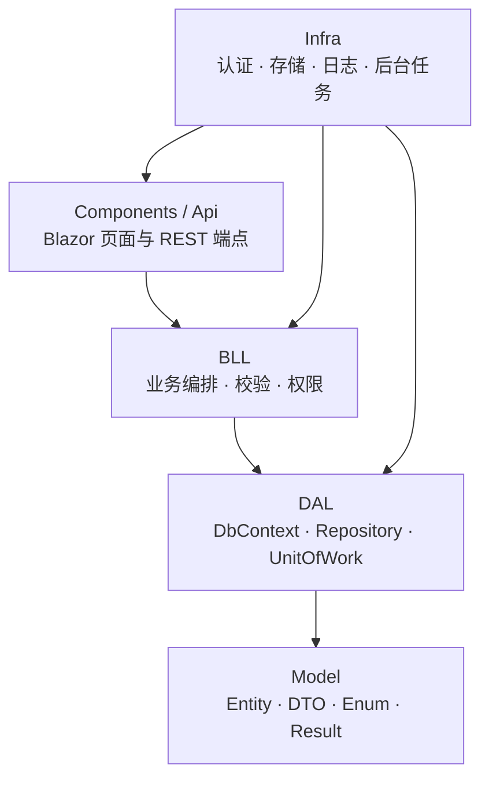

<div align="center">

# ExamOps

### 把发考、监考、阅卷和成绩公布，收进一条可审计的流程

**面向企业内网与培训考核的客观题考试平台**<br>
4 步极速发考 · 权限感知运营看板 · 服务端权威计时 · 全链路审计

<p>
  
  
  
  
  
  
</p>

[核心能力](#核心能力) · [快速开始](#快速开始) · [架构设计](#架构设计) · [安全与审计](#安全与审计) · [生产运维](#生产运维) · [验证命令](#验证命令)

</div>

---

## 项目定位

ExamOps 是一套**单工程、可离线交付、权限边界清晰**的考试运营工具，覆盖组织与题库、组卷发考、在线作答、复核调分、成绩发布和报表导出。

当前版本聚焦**单选、多选和判断题**，不包含主观题人工阅卷、题库去重算法或分布式集群能力。生产部署边界为**单实例应用 + PostgreSQL**；本地文件、Blazor SignalR Circuit 和登录限流均保存在进程内。

| 场景 | ExamOps 提供的路径 |
| :--- | :--- |
| 建部门、导员工、录题、发考来回跳转 | 组织模板、员工/题库 XLSX 批量导入、四步发考向导 |
| 考试进度靠人工导出比对 | 权限感知实时看板、进度抽屉、未考名单一键复制 |
| 已发布题目或试卷被误改 | 不可变版本发布，修订通过新草稿推进 |
| 调分只有结果、没有依据 | 保留原始自动分，调分原因与历史完整留痕 |
| 停用账号后旧页面仍可操作 | 会话注册表与数据库探针协同撤销在线会话 |
| 内网无法访问 CDN 或额外组件 | 无前端 CDN；XLSX 与二维码基于 .NET BCL 实现 |

## 核心能力

### 1. 考务管理：从组织到发考

- **组织与人员**：行业组织模板、部门树、岗位预设、员工批量导入与初始密码清单。
- **题库管理**：XLSX 模板导入、行级错误反馈、草稿/发布状态管理、已发布版本保护。
- **四步极速发考**：选题库 → 选题型与分值 → 设置时间与对象 → 预览并原子发布。
- **两种组卷方式**：固定题组卷，或按题型与数量建立随机候选题池。
- **实时运营看板**：按 RBAC 权限和部门数据范围组装 KPI、进度、统计图与近期考试。
- **批量下发**：支持部门及下级部门；考试安排可通过本地生成的 SVG 二维码分享。

### 2. 命题与复核：结果可解释，变更可追溯

- **精确自动判分**：多选题全对得分，交卷后保存原始 `auto_score`。
- **异常复核**：记录格式异常、判分异议与作废申请。
- **调分留痕**：强制填写调分原因，保留每次调整的操作者、时间与前后分值。
- **成绩发布快照**：支持 `Latest / First / Highest / Average` 策略，发布内容带 SHA-256 校验。
- **鉴权报表**：按部门、考试、角色等维度统计，导出 CSV/XLSX 时防公式注入。

### 3. 考生作答：专注答题，断线不丢

- **极简考生模式**：仅含 `Candidate` 角色的账号隐藏管理导航。
- **服务端计时**：倒计时、开放时间与截止宽限由服务端判定，不信任浏览器时间。
- **自动保存**：每 30 秒保存，并在浏览器本地暂存未同步答卷用于断线恢复。
- **成绩保密**：未发布成绩前隐藏分数与答案；发布后展示最终分、来源答卷与发布批次。
- **会话撤销**：账号停用、改密或权限变化后，在线会话会被主动下线。

## 快速开始

> [!WARNING]
> 当前代码基线为 **.NET 8 / EF Core 8**。.NET 8 已于 **2026 年 11 月 10 日结束官方支持**，详见 [.NET 支持策略](https://dotnet.microsoft.com/zh-cn/platform/support/policy/dotnet-core)。可用于本地评估与内网验证；生产使用前应完成运行时升级与兼容性验证。

### 环境要求

- [.NET 8 SDK](https://dotnet.microsoft.com/zh-cn/download/dotnet/8.0)
- [PostgreSQL 17](https://www.postgresql.org/download/)
- `psql`、`createdb` 命令行工具
- 支持 WebSocket 的现代浏览器

### 第 1 步：获取代码

```bash
git clone https://github.com/tmy2623231/ExamOps.git
cd ExamOps
```

### 第 2 步：创建数据库与最小权限角色

以下命令以本机 PostgreSQL 管理员 `postgres` 为例。请将 `REPLACE_WITH_A_STRONG_PASSWORD` 替换为独立强密码。

```bash
createdb -h 127.0.0.1 -U postgres examops_db
psql -h 127.0.0.1 -U postgres -d examops_db
```

在 `psql` 中执行：

```sql
CREATE ROLE examops_app LOGIN PASSWORD 'REPLACE_WITH_A_STRONG_PASSWORD';
\q
```

### 第 3 步：按顺序初始化数据库

必须先生成表结构与种子数据，最后收紧应用角色权限；不要调换 `seed.sql` 与 `security.sql` 的顺序。

```bash
psql -h 127.0.0.1 -U postgres -d examops_db -v ON_ERROR_STOP=1 -f sql/schema.sql
psql -h 127.0.0.1 -U postgres -d examops_db -v ON_ERROR_STOP=1 -f sql/seed.sql
psql -h 127.0.0.1 -U postgres -d examops_db -v ON_ERROR_STOP=1 -f sql/security.sql
```

数据库 Schema 的单一权威源是 [`sql/schema.sql`](sql/schema.sql)，当前要求版本 **1.1.0**。项目采用 SQL-first，不再引入 EF Migrations。

### 第 4 步：注入配置并初始化管理员

PowerShell 示例：

```powershell
$env:EXAMOPS_DB_CONNECTION = "Host=127.0.0.1;Port=5432;Database=examops_db;Username=examops_app;Password=YOUR_APP_DB_PASSWORD;SSL Mode=Disable"
$env:EXAMOPS_ADMIN_PASSWORD = "YOUR_12_TO_128_CHAR_ADMIN_PASSWORD"

dotnet run --project ExamOps.csproj -- --init-admin
```

也可以复制 [`appsettings.example.json`](appsettings.example.json) 为本地 `appsettings.json` 后修改；该文件已被 `.gitignore` 排除。生产环境禁止使用 `postgres` 超级用户、空密码或占位密码启动。

### 第 5 步：启动并登录

```powershell
dotnet run --project ExamOps.csproj
```

默认监听 **`0.0.0.0:5080`**。本机访问 <http://localhost:5080>，局域网访问 `http://<服务器IP>:5080`，使用 `admin` 与刚设置的密码登录。

仅监听本机或修改端口：

```powershell
dotnet run --no-launch-profile --project ExamOps.csproj --urls http://127.0.0.1:8080
```

## 架构设计

### 业务闭环


### 单向分层



关键约定：

- `Components / Api → BLL → DAL → Model`，上层依赖下层，反向依赖被禁止。
- 数据库上下文通过 `IDbContextFactory<ExamDbContext>` 创建，禁止业务代码直接 `new DbContext()`。
- 只读查询使用 `AsNoTracking()`；分页必须带唯一列兜底排序。
- 跨表写入使用共享 `DbContext` 或显式事务；业务写操作必须落审计日志。
- 用户上传、导出、日志与临时文件只写入 `Data/`，数据库只保存相对正斜杠路径。

<details>
<summary><strong>查看项目结构</strong></summary>

```text
ExamOps/
├─ Api/                          # REST 端点、模板下载、鉴权导出
├─ BLL/                          # 业务服务、权限与数据范围、自检编排
├─ Components/
│  ├─ Layout/                    # 主布局、命令面板、主题、会话守护
│  ├─ Pages/                     # 看板、发考、作答、复核、公布、报表
│  └─ Shared/                    # 图表、二维码、模态框、分页等共享组件
├─ DAL/                          # EF Core 上下文、配置、Repository、UnitOfWork
├─ Infra/                        # 认证、会话、存储、日志、导入、后台任务
├─ Model/                        # 实体、DTO、枚举与通用返回类型
├─ sql/
│  ├─ schema.sql                 # Schema 1.1.0 单一权威源
│  ├─ seed.sql                   # 幂等角色、权限与初始组织数据
│  ├─ security.sql               # 最小权限与追加型数据保护
│  └─ smoke_test.sql             # 数据库结构与约束冒烟检查
├─ wwwroot/                      # 静态资源、主题样式与官方导入模板
├─ .github/workflows/ci.yml      # Release 构建与离线自检
├─ ExamOps.csproj                # .NET 8 单工程
├─ appsettings.example.json      # 无真实密钥的配置模板
└─ README.md
```

</details>

## 安全与审计

| 控制点 | 实现方式 |
| :--- | :--- |
| 身份与权限 | Cookie 认证、37 项细粒度权限、9 个系统角色、部门数据范围 |
| 会话撤销 | `UserSessionRegistry` 广播 + 数据库状态探针，旧 Circuit 与 Cookie 一并失效 |
| 生产密钥 | 非 Development 环境拒绝空密码、占位密码与 `postgres` 超级用户 |
| 数据库权限 | `examops_app` 最小权限；审计、答卷事件、调分与成绩快照禁止更新/删除 |
| 文件导入 | 校验扩展名、OOXML/ZIP 结构、XML 与解压上限，拒绝宏、公式和外部链接 |
| 文件隔离 | GUID 命名、`Data/` 存储、相对路径入库、鉴权下载与 `nosniff` |
| 请求防护 | 默认认证策略、防伪令牌、登录/导入限流、生产 HSTS 与 Secure Cookie |
| 审计追溯 | 业务写操作记录操作者、动作、实体与结果；关键事实表只追加 |

发现安全问题请使用 [GitHub 私密漏洞报告](https://github.com/tmy2623231/ExamOps/security/advisories/new)。不要在公开 Issue 中提交凭据、连接串、个人数据或尚未修复的漏洞细节。

## 生产运维

> [!IMPORTANT]
> **当前仅支持单实例部署。** 反向代理必须支持 WebSocket 长连接，并正确透传 `X-Forwarded-For` 与 `X-Forwarded-Proto`。多实例共享数据库前，需要先将文件存储、会话注册表和限流状态外置。

### 健康检查

| 端点 | 检查内容 | 正常 | 异常 |
| :--- | :--- | :--- | :--- |
| `GET /health/live` | 进程是否响应 | `200` | 由进程/编排器处理 |
| `GET /health/ready` 或 `GET /health` | PostgreSQL、Schema 1.1.0、数据目录可写性 | `200` | `503` |

### 部署清单

1. 使用受支持的 .NET 运行时，并通过 `EXAMOPS_DB_CONNECTION` 或受控密钥系统注入连接串。
2. 设置 `ASPNETCORE_ENVIRONMENT=Production`，启用 HTTPS、HSTS 与 Secure Cookie。
3. 只信任实际反向代理地址；远程代理在 `ReverseProxy:KnownProxies` 中显式声明。
4. 将 `AllowedHosts` 从模板中的 `*` 收紧为实际域名或 IP。
5. 为 `Data/` 配置持久化磁盘、备份与最小文件系统权限。
6. 启动后检查 `/health/ready`、`Data/logs/error/` 与审计记录。
7. 应用配置 30 秒优雅停机；发布或回滚时等待旧进程与端口完全释放。

### 备份与恢复

数据库与 `Data/uploads` 必须作为一致性备份单元。恢复前停止应用，避免备份期间继续写入。

```powershell
# 在仓库根目录执行
New-Item -ItemType Directory -Force -Path backup | Out-Null
pg_dump -h 127.0.0.1 -U postgres -Fc -f "backup/examops_$(Get-Date -Format yyyyMMdd_HHmm).dump" examops_db
Compress-Archive -Path "Data/uploads" -DestinationPath "backup/uploads_$(Get-Date -Format yyyyMMdd_HHmm).zip" -Force

# 恢复演练：先停止应用，再恢复数据库与上传文件
pg_restore -h 127.0.0.1 -U postgres --clean --if-exists -d examops_db "backup/examops_YYYYMMDD_HHMM.dump"
Expand-Archive -Path "backup/uploads_YYYYMMDD_HHMM.zip" -DestinationPath "Data" -Force
```

恢复后检查 `/health/ready`，抽查附件下载、成绩发布快照与审计记录，并记录恢复演练结果。

### 升级与回滚

- 应用启动强校验 Schema **1.1.0**；数据库升级必须先确认新旧应用兼容。
- 普通回滚只切换应用二进制，保留兼容的数据库与 `Data/`，不要把结构降级脚本当作通用回滚方案。
- 涉及 Schema 变更时，先备份，再在临时库完成升级与恢复演练。
- 回滚后检查就绪端点、错误日志、端口占用和关键业务链路。

## 验证命令

### Release 构建

```powershell
dotnet restore ExamOps.sln
dotnet build ExamOps.sln --configuration Release --no-restore
```

### 离线算法与 XLSX 解析自检

这两个命令不会连接数据库，但依赖注入阶段仍要求格式合法的连接串。PowerShell 可设置一个仅用于自检的占位配置：

```powershell
$env:EXAMOPS_DB_CONNECTION = "Host=127.0.0.1;Port=5432;Database=examops_check;Username=examops_check;Password=offline-check-only;SSL Mode=Disable"

dotnet run --no-build --configuration Release --project ExamOps.csproj -- --self-check
dotnet run --no-build --configuration Release --project ExamOps.csproj -- --import-parser-check
```

### 数据库与业务事务自检

以下命令需要连接已初始化的数据库；Phase 1–5 使用事务回滚，不保留测试业务数据。

```powershell
psql -h 127.0.0.1 -U postgres -d examops_db -v ON_ERROR_STOP=1 -f sql/smoke_test.sql

dotnet run --no-build --configuration Release --project ExamOps.csproj -- --phase1-check
dotnet run --no-build --configuration Release --project ExamOps.csproj -- --phase2-check
dotnet run --no-build --configuration Release --project ExamOps.csproj -- --phase3-check
dotnet run --no-build --configuration Release --project ExamOps.csproj -- --phase4-check
dotnet run --no-build --configuration Release --project ExamOps.csproj -- --phase4-concurrency-check
dotnet run --no-build --configuration Release --project ExamOps.csproj -- --phase5-check
```

GitHub Actions 在 `main` 推送与 Pull Request 时执行 Release 构建、算法自检与 XLSX 解析自检。

## 参与贡献

提交变更前请先搜索已有 [Issues](https://github.com/tmy2623231/ExamOps/issues)；较大的功能或架构调整建议先讨论。提交 Pull Request 时请说明变更目的、验证命令、数据库影响与回滚方式。

请保持分层方向与 SQL-first 约定，不提交真实密钥、个人数据、业务导出文件或 `Data/` 内容。数据库结构变更需同步更新 `sql/schema.sql` 与 `sql/smoke_test.sql`，并在临时数据库中验证。

## 设计与动效致谢

界面采用 Swiss Minimalism 理性设计体系，支持浅色/深色主题、移动端适配与 `prefers-reduced-motion` 无障碍降级。昼夜天空开关、`Ctrl+K` 命令面板、堆叠通知、滚动数字、动态环形图、滑动单选卡与四步向导进度条参考了 [Lucian UX/UI Prompt](https://lucianlabs.dev/uxui-prompt)（MIT License），对应组件保留许可证声明。
